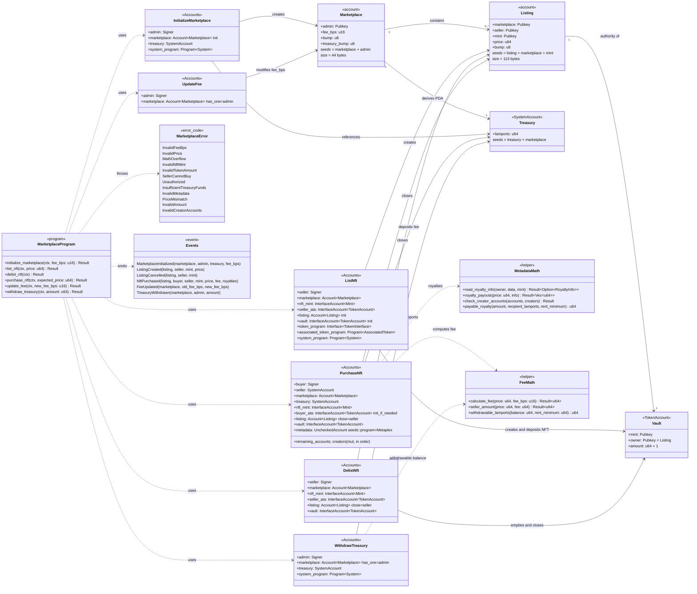

# 02 — Class Diagram

Solana has no classes in the strict sense: the Anchor program is modeled as **state accounts** (data), **instruction contexts** (`#[derive(Accounts)]`), **errors** and **events**. The frontend is modeled as components, hooks and utilities.

---

## 2.1 On-chain program (Anchor / Rust)



### Key constraints per context

| Context | Explicit constraints |
|---|---|
| `InitializeMarketplace` | `init`, `payer = admin`, `space = 44`, `seeds = [b"marketplace", admin]`, `bump`; `constraint = fee_bps <= MAX_FEE_BPS` |
| `ListNft` | `listing`: `init`, `seeds = [b"listing", marketplace, nft_mint]`; `seller_ata`: `associated_token::authority = seller`; `nft_mint`: `constraint = decimals == 0 && supply == 1` |
| `DelistNft` | `listing`: `has_one = seller`, `has_one = mint`, `close = seller`; `vault`: `associated_token::authority = listing` |
| `PurchaseNft` | `listing`: `has_one = seller`, `has_one = marketplace`, `close = seller`, `constraint = listing.seller != buyer @ SellerCannotBuy`, `constraint = listing.price == expected_price @ PriceMismatch`; `treasury`: `seeds = [b"treasury", marketplace]`, `bump = marketplace.treasury_bump`; `metadata`: `seeds = [b"metadata", TOKEN_METADATA_PROGRAM_ID, nft_mint]`, `seeds::program = TOKEN_METADATA_PROGRAM_ID`; creators in `remaining_accounts` → `InvalidCreatorAccounts` |
| `UpdateFee` / `WithdrawTreasury` | `marketplace`: `has_one = admin`; `admin`: `Signer` |

---

## 2.2 Frontend (Next.js App Router)

```mermaid
classDiagram
    direction TB

    class RootLayout {
        <<server>>
        +children: ReactNode
    }
    class Providers {
        <<client>>
        ThemeProvider
    }
    class SolanaProvider {
        <<client>>
        ConnectionProvider
        WalletProvider wallets=[]
        WalletModalProvider
    }
    class Navbar {
        <<server>>
    }
    class ThemeToggle {
        <<client>>
        +resolvedTheme: string
        +setTheme(theme) void
    }
    class useIsClient {
        <<hook>>
        +isClient: boolean
    }
    class ConceptCard {
        +concept: HelpConcept
    }
    class ExplorerLinks {
        +signature: string
        +cluster: Cluster
    }
    class config {
        <<lib>>
        +parseConfig(env) AppConfig
        +appConfig: AppConfig
    }
    class help {
        <<lib>>
        +HELP_TEXTS: HelpEntry per HelpConcept
    }
    class WalletButton {
        <<client>>
    }

    class HomePage {
        <<route>>
        path = /
    }
    class ListingDetailPage {
        <<route>>
        path = /listing/mint
        +params: mint
    }
    class SellPage {
        <<route>>
        path = /sell
    }
    class AdminPage {
        <<route>>
        path = /admin
    }

    class ListingGrid {
        <<client>>
    }
    class ListingCard {
        +listing: ListingView
        +feeBps: number
    }
    class ListingDetail {
        <<client>>
        +mint: string
    }
    class ListingInfo {
        +listing: ListingView
        +feeBps: number
    }
    class PriceBreakdown {
        +breakdown: SaleBreakdown
    }
    class ListingActions {
        <<client>>
        +listing: ListingView
        +onDone() void
    }
    class SellView {
        <<client>>
    }
    class WalletNftPicker {
        +nfts: AsyncData~WalletNft[]~
        +selected: string
        +onSelect(mint) void
    }
    class SellForm {
        +feeBps: number
        +royalty: RoyaltyInfo
        +onSubmit(priceLamports: bigint) void
    }
    class NftImage {
        +src: string
        +name: string
        +size: number
    }
    class AdminView {
        <<client>>
        no wallet / no permissions / panel
    }
    class AdminPanel {
        <<client>>
        +marketplace: MarketplaceView
        +onFeeUpdated() void
    }
    class TreasuryStats {
        +marketplace: MarketplaceView
        +treasury: TreasuryView
    }
    class FeeForm {
        +currentFeeBps: number
        +onSubmit(feeBps: number) void
    }
    class WithdrawForm {
        +withdrawableLamports: bigint
        +onSubmit(lamports: bigint) void
    }
    class AdminFormShell {
        +form: ConfirmedForm~T~
        +confirmMessage(value: T) ReactNode
    }
    class ConfirmDialog {
        +message: ReactNode
        +onConfirm() void
        +onCancel() void
    }
    class FormField {
        +label: string
        +value: string
        +error: string
    }

    class Tooltip {
        +content: string
        +children: ReactNode
    }
    class HelpIcon {
        +concept: HelpConcept
    }
    class Skeleton
    class Spinner
    class TxStatusToast {
        +status: TxStatus
        +signature: string
        +cluster: Cluster
        +error: AppError
        +onDismiss() void
    }

    class useMarketplaceProgram {
        <<hook>>
        +program: Program~Marketplace~
    }
    class useAsyncData {
        <<hook>>
        +data: T
        +error: AppError
        +isLoading: boolean
        +refetch() void
    }
    class useMarketplaceData {
        <<hook>>
        +useMarketplace() AsyncData~MarketplaceView~
        +useListings() AsyncData~ListingView[]~
        +useListing(mint) AsyncData~ListingView~
        +useWalletNfts() AsyncData~WalletNft[]~
        +useTreasury() AsyncData~TreasuryView~
    }
    class useTransaction {
        <<hook>>
        +status: TxStatus
        +signature: string
        +error: AppError
        +execute(build, onSuccess) Promise~boolean~
        +reset() void
    }
    class useListNft {
        <<hook>>
        +execute(nft, priceLamports) Promise~boolean~
    }
    class useDelistNft {
        <<hook>>
        +execute(listing) Promise~boolean~
    }
    class usePurchaseNft {
        <<hook>>
        +execute(listing) Promise~boolean~
    }
    class instructions {
        <<lib>>
        +buildListNftIx(program, params) Promise
        +buildDelistNftIx(program, params) Promise
        +buildPurchaseNftIx(program, params) Promise
        +buildUpdateFeeIx(program, params) Promise
        +buildWithdrawTreasuryIx(program, params) Promise
    }
    class listings {
        <<lib>>
        +fetchMarketplace(program, address) Promise
        +fetchListings(program, marketplace) Promise
        +fetchListing(program, marketplace, mint) Promise
        +fetchWalletNfts(connection, owner) Promise
        +fetchTreasury(connection, programId, marketplace) Promise
        +loadNftDisplays(connection, mints) Promise
    }
    class metadata {
        <<lib>>
        +parseMetadata(data) ParsedMetadata
        +fetchOffchainJson(uri) Promise
    }
    class fees {
        <<lib>>
        +estimateFee(price, feeBps) bigint
        +estimateRoyalties(price, royalty) bigint
        +breakdownSale(price, feeBps, royalty) SaleBreakdown
    }
    class useUpdateFee {
        <<hook>>
        +execute(newFeeBps) Promise~boolean~
    }
    class useWithdrawTreasury {
        <<hook>>
        +execute(amountLamports) Promise~boolean~
    }
    class useConfirmedForm {
        <<hook>>
        +value: string
        +pending: T
        +submit(event) void
        +confirm() void
        +cancel() void
    }

    class pda {
        <<lib>>
        +findMarketplacePda(admin) PublicKey
        +findListingPda(marketplace, mint) PublicKey
        +findTreasuryPda(marketplace) PublicKey
    }
    class schemas {
        <<lib>>
        +publicKeySchema
        +mintParamSchema
        +feeBpsSchema
        +priceSolSchema
        +feeBpsInputSchema
        +withdrawAmountSchema(withdrawable)
    }
    class errors {
        <<lib>>
        +mapError(e: unknown) AppError
    }
    class explorer {
        <<lib>>
        +txUrl(signature, cluster, explorer) string
        +accountUrl(address, cluster, explorer) string
    }
    class TxStatus {
        <<enumeration>>
        idle
        signing
        confirming
        success
        error
    }

    RootLayout *-- Providers
    Providers *-- SolanaProvider
    RootLayout *-- Navbar
    Navbar *-- ThemeToggle
    Navbar *-- WalletButton
    ThemeToggle ..> useIsClient
    WalletButton *-- Skeleton
    SolanaProvider ..> config
    Navbar ..> config
    HomePage *-- ConceptCard
    ConceptCard *-- HelpIcon
    HelpIcon ..> help
    TxStatusToast *-- ExplorerLinks
    ExplorerLinks ..> explorer

    HomePage *-- ListingGrid
    ListingGrid *-- ListingCard
    ListingGrid *-- Skeleton
    ListingCard *-- NftImage
    ListingDetailPage *-- ListingDetail
    ListingDetail *-- ListingInfo
    ListingDetail *-- ListingActions
    ListingInfo *-- PriceBreakdown
    ListingActions *-- TxStatusToast
    SellPage *-- SellView
    SellView *-- WalletNftPicker
    SellView *-- SellForm
    SellView *-- TxStatusToast
    SellForm *-- PriceBreakdown
    AdminPage *-- AdminView
    AdminView *-- AdminPanel
    AdminView ..> useMarketplaceData
    AdminPanel *-- TreasuryStats
    AdminPanel *-- FeeForm
    AdminPanel *-- WithdrawForm
    AdminPanel *-- TxStatusToast
    FeeForm *-- AdminFormShell
    WithdrawForm *-- AdminFormShell
    AdminFormShell *-- ConfirmDialog
    FeeForm *-- FormField
    WithdrawForm *-- FormField
    SellForm *-- FormField
    FeeForm ..> useConfirmedForm
    WithdrawForm ..> useConfirmedForm

    SellForm *-- HelpIcon
    ListingCard *-- HelpIcon
    PriceBreakdown *-- HelpIcon
    TreasuryStats *-- HelpIcon
    TreasuryStats *-- Skeleton
    FeeForm *-- HelpIcon
    WithdrawForm *-- HelpIcon
    Navbar ..> useMarketplaceData
    HelpIcon *-- Tooltip

    ListingGrid ..> useMarketplaceData
    ListingDetail ..> useMarketplaceData
    SellView ..> useMarketplaceData
    SellView ..> useListNft
    ListingActions ..> usePurchaseNft
    ListingActions ..> useDelistNft
    AdminPanel ..> useUpdateFee
    AdminPanel ..> useWithdrawTreasury
    AdminPanel ..> useMarketplaceData

    useMarketplaceData ..> useAsyncData
    useMarketplaceData ..> listings
    useAsyncData ..> errors
    listings ..> metadata
    listings ..> pda
    useListNft ..> useTransaction
    useDelistNft ..> useTransaction
    usePurchaseNft ..> useTransaction
    useUpdateFee ..> useTransaction
    useWithdrawTreasury ..> useTransaction
    useUpdateFee ..> instructions
    useWithdrawTreasury ..> instructions
    useTransaction ..> TxStatus
    useTransaction ..> errors
    useMarketplaceData ..> useMarketplaceProgram
    useListNft ..> instructions
    usePurchaseNft ..> instructions
    useDelistNft ..> instructions
    instructions ..> pda
    PriceBreakdown ..> fees
    SellForm ..> schemas
    FeeForm ..> schemas
    WithdrawForm ..> schemas
    TxStatusToast *-- Spinner
```



### Shared frontend types

```typescript
/** Royalties from the Metaplex metadata (creators in metadata order). */
export interface RoyaltyInfo {
  sellerFeeBasisPoints: number;
  creators: { address: string; share: number }[];
}

/** Visible data of an NFT (on-chain + off-chain JSON). */
export interface NftDisplay {
  name: string;
  imageUrl: string | null;
  royalty: RoyaltyInfo | null;
}

/** View of a listing ready to render. */
export interface ListingView {
  address: string;       // Listing PDA
  marketplace: string;
  seller: string;
  mint: string;
  priceLamports: bigint;
  nft: NftDisplay;
}

/** Listable NFT from the wallet. */
export interface WalletNft {
  mint: string;
  tokenProgram: string;  // SPL Token or Token-2022
  nft: NftDisplay;
}

/** Normalized error for the UI. */
export interface AppError {
  code: "WALLET_NOT_CONNECTED" | "WALLET_REJECTED" | "INSUFFICIENT_SOL" | "PROGRAM_ERROR" | "NETWORK" | "UNKNOWN";
  message: string;       // user-facing message in Spanish
}

/** Concepts with a help tooltip. */
export type HelpConcept = "BPS" | "PDA_ESCROW" | "RENT" | "ROYALTIES";
```
