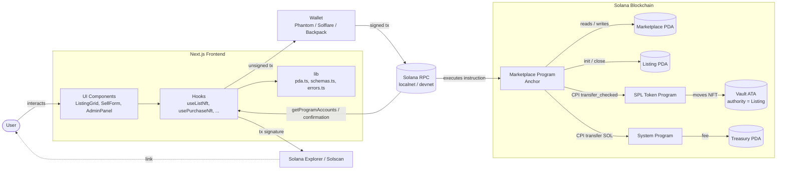
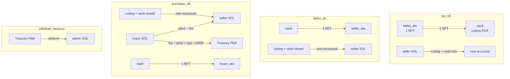
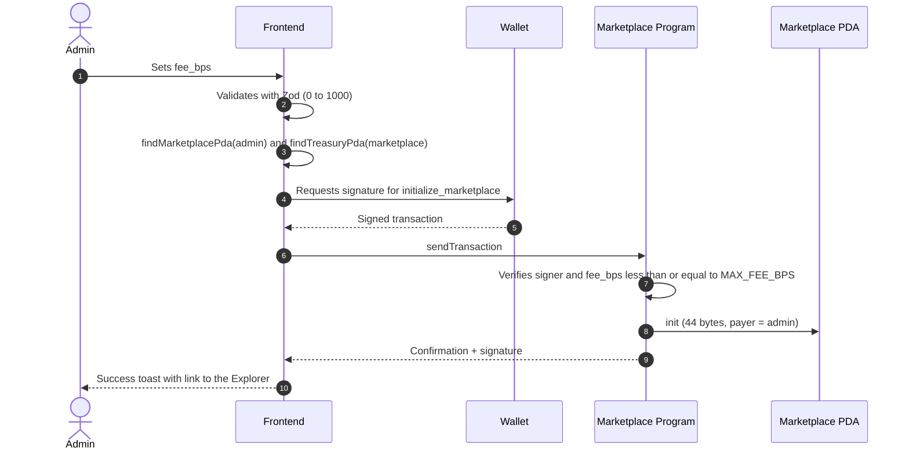
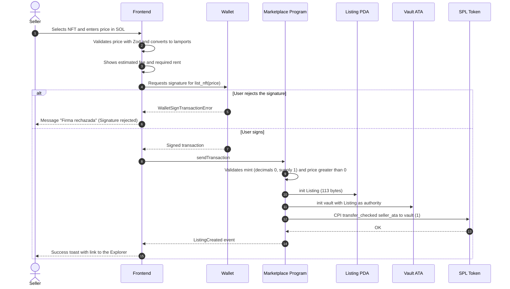
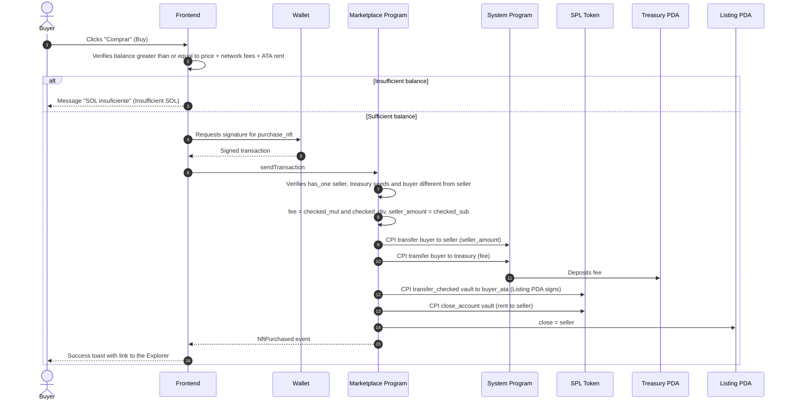
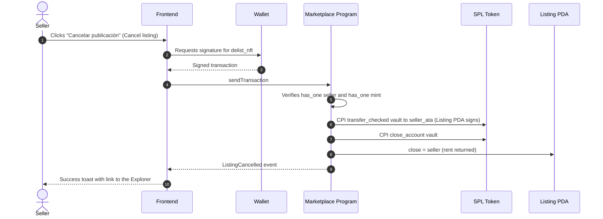
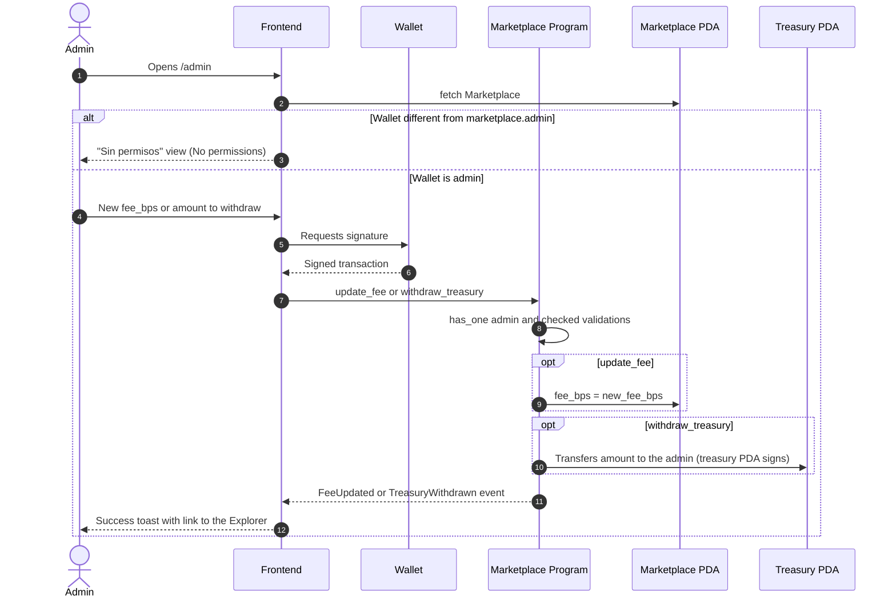

# 03 — Flow Diagram (data and transaction flow)

This document shows **how data and assets** (SOL and NFTs) **travel** between the system's actors: user, frontend, wallet, RPC, Anchor program and on-chain accounts. The step-by-step decision logic is in [04-flujograma-EN.md](./04-flujograma-EN.md).

---

## 3.1 Architecture and overall data flow

---

## 3.2 Asset flow per instruction

---

## 3.3 Sequence: initialize the marketplace

---

## 3.4 Sequence: list an NFT (`list_nft`)

---

## 3.5 Sequence: buy an NFT (`purchase_nft`)

---

## 3.6 Sequence: cancel a listing (`delist_nft`)

---

## 3.7 Sequence: administration (`update_fee` / `withdraw_treasury`)

