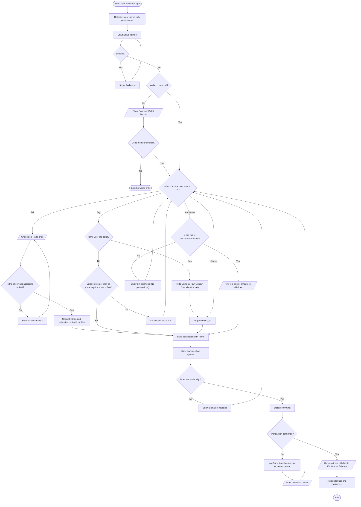
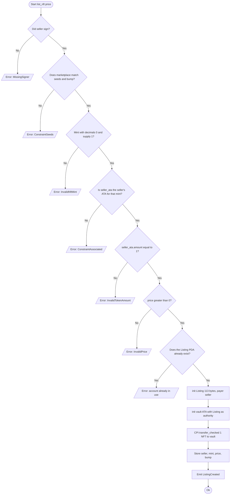
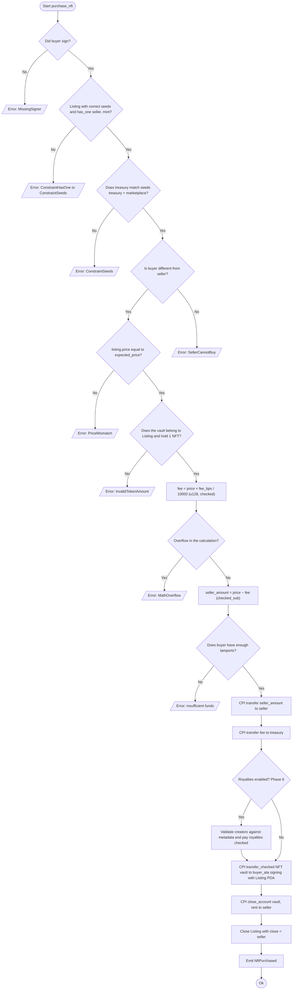
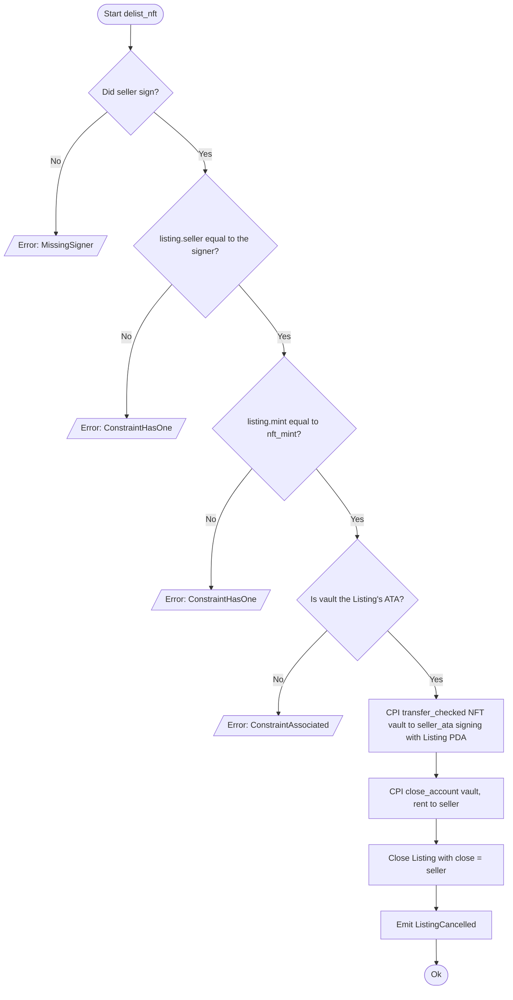
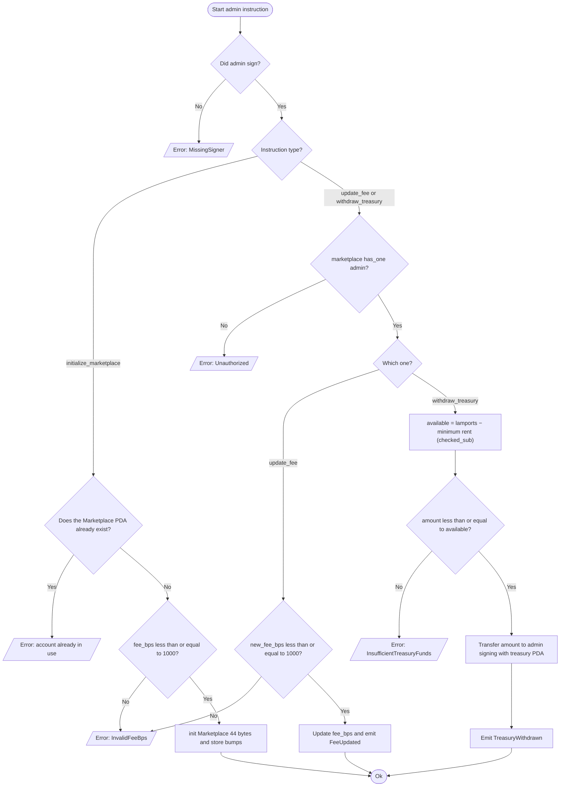

# 04 — Flowchart (decision logic)

While the [data flow diagram](./03-diagrama-de-flujo-EN.md) shows how data and assets move between actors, this flowchart describes **the step-by-step logic with its decisions**: the user's journey through the interface and the validations each on-chain instruction performs.

**Symbols:** `([ ])` start/end · `[ ]` process · `{ }` decision · `[/ /]` input/output.

---

## 4.1 User journey in the frontend

---

## 4.2 On-chain validations of `list_nft`

---

## 4.3 On-chain validations of `purchase_nft`

---

## 4.4 On-chain validations of `delist_nft`

---

## 4.5 On-chain administration validations

> **Note:** `has_one admin` is not applied in `initialize_marketplace` because the account does not exist yet; the PDA is derived with `seeds = [b"marketplace", admin]`, which binds the configuration to the signer.
